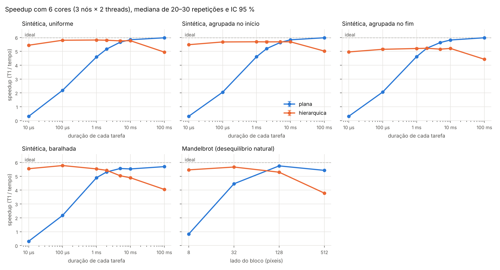
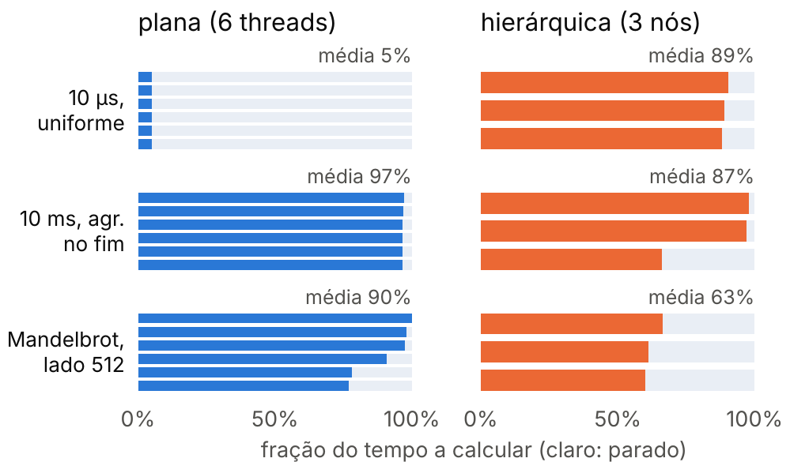
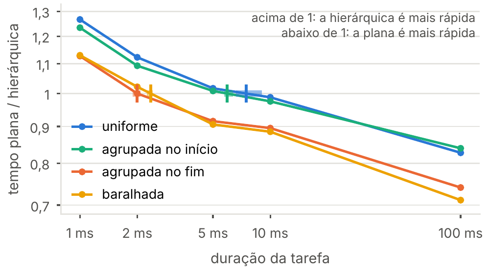
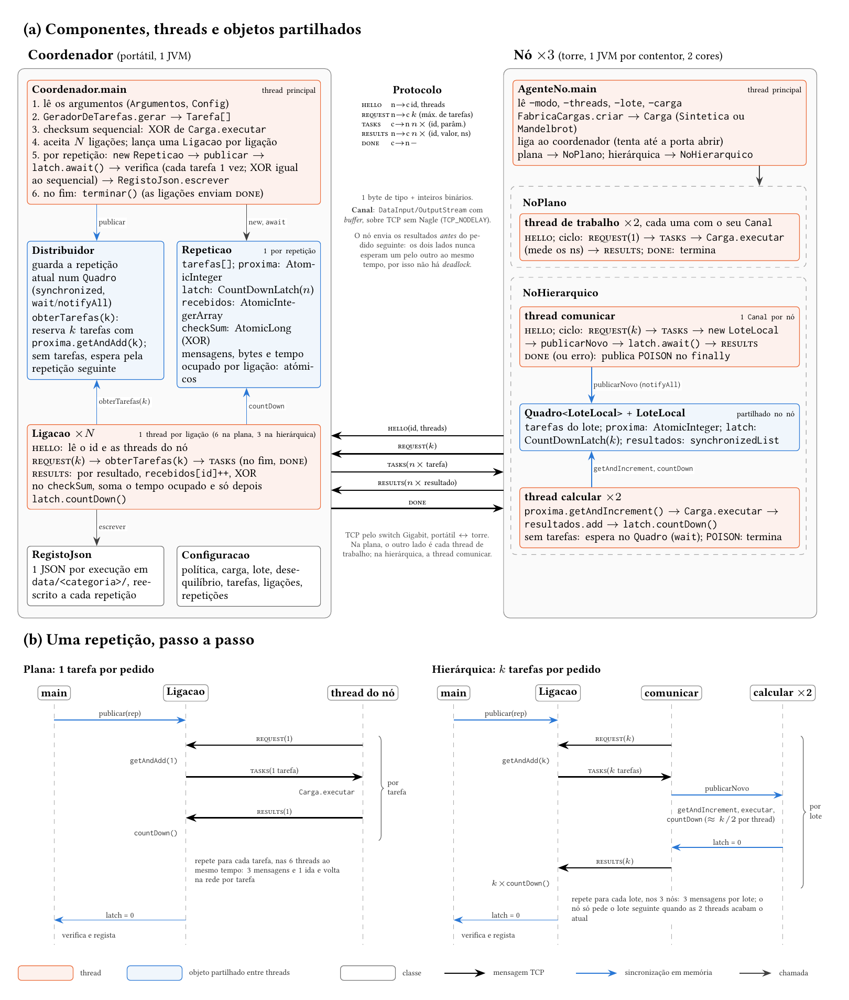
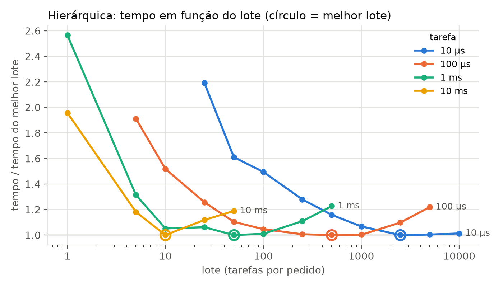

# batchpoint

**Distribuição de tarefas plana vs. hierárquica num pequeno cluster emulado**

Projeto de Programação Paralela e Concorrente: 
Mestrado em Engenharia Informática,
Faculdade de Ciências da Universidade de Lisboa.
Autor: Gonçalo Lourenço (fc68092).

Java 21 · Maven · Docker · TCP · Python (pandas, matplotlib, scipy)

---

## Índice

1. [Resumo](#resumo)
2. [Perguntas e hipóteses](#perguntas-e-hipóteses)
3. [Resultados](#resultados)
4. [Arquitetura](#arquitetura)
5. [Ambiente experimental](#ambiente-experimental)
6. [Metodologia](#metodologia)
7. [Estrutura do repositório](#estrutura-do-repositório)
8. [Como reproduzir](#como-reproduzir)
9. [Formato dos dados](#formato-dos-dados)

---

## Resumo

Num sistema master-worker distribuído, um coordenador reparte tarefas independentes por
nós ligados em rede. Este projeto compara duas formas de o fazer:

- **Plana** -> cada thread de cada nó pede ao coordenador uma tarefa de cada vez.
- **Hierárquica** -> um gestor em cada nó pede um lote de *k* tarefas e reparte-o pelas threads
  do nó.

A plana equilibra melhor a carga, mas paga uma ida e volta na rede por tarefa. A hierárquica
paga uma por lote, mas pode deixar threads paradas quando os lotes custam tempos diferentes.
O estudo mede, num cluster de 3 nós com 2 cores cada, em que tamanhos de tarefa e
desequilíbrios de carga cada política é mais rápida, e onde fica o ponto em que se cruzam.

As duas políticas foram implementadas de raiz em Java, sobre TCP, e partilham o código de
cálculo e o protocolo: só mudam o tamanho do lote e a forma como o nó o reparte.

## Perguntas e hipóteses

**RQ1.** Com 6 cores (3 nós × 2), para que tamanhos de tarefa e desequilíbrios de carga a
política hierárquica tem menor tempo total do que a plana, e vice-versa?

| Hipótese | Enunciado | Estado |
| --- | --- | --- |
| H1 | Com tarefas pequenas, a hierárquica é mais rápida. | Confirmada |
| H2 | Com tarefas grandes e carga desequilibrada, a plana é mais rápida. | Confirmada |
| H3 | Há um ponto de cruzamento, que se desloca para tarefas mais pequenas quando o desequilíbrio aumenta. | Confirmada |

**RQ2.** Uma política hierárquica com *work stealing* entre nós iguala a melhor das outras duas
em toda a grelha? (*em curso.*)

## Resultados

Corrida final de 8 de novembro de 2026: 64 configurações, 30 repetições medidas cada
(20 nos 100 ms), por ordem aleatória, numa só sessão.

### Speedup



*Speedup (T₁/T₆): mediana e intervalo de confiança a 95 % (bootstrap). T₁ é a mesma carga com
1 nó de 1 thread, pelo mesmo caminho (Docker, rede, coordenador).*

### Razão plana / hierárquica

Razão das medianas do tempo por repetição (> 1: a hierárquica é mais rápida). Todas as
diferenças são significativas (Mann-Whitney U com correção de Holm, p < 0,01), exceto a
marcada com \*. † indica lote ímpar (ver abaixo).

| Tarefa | Uniforme | Agrupada no início | Agrupada no fim | Baralhada |
| --- | ---: | ---: | ---: | ---: |
| 10 µs | 17,6 | 17,5 | 15,7 | 17,8 |
| 100 µs | 2,65 | 2,77 | 2,50 | 2,65 |
| 1 ms | 1,27 | 1,23 | 1,13 | 1,13 |
| 2 ms | 1,12 | 1,09 | 1,00\* | 1,02 |
| 5 ms | 1,02 | 1,01 | 0,92 | 0,91 |
| 10 ms | 0,99 | 0,98 | 0,90 | 0,89 |
| 100 ms | 0,83† | 0,84† | 0,74† | 0,71† |

Mandelbrot, lado 8 / 32 / 128 / 512: 6,58 / 1,27 / 0,92 / 0,70†.

### H1 - tarefas pequenas

Com 10 µs, a hierárquica é 15,7 a 17,8× mais rápida. A causa é o número de mensagens: a plana
troca 720 000 por repetição e a hierárquica 72, para um volume parecido (4,0 vs. 2,8 MB).
As threads da plana passam 95 % do tempo à espera da rede.

### H2 - tarefas grandes com desequilíbrio

Com 5 e 10 ms e as tarefas longas no fim da fila ou baralhadas, a plana é 1,09 a 1,13× mais
rápida (δ de Cliff = −1); no Mandelbrot com blocos de 128, 1,09×. Com as longas no fim, os
dois últimos lotes são pesados e prendem dois nós, enquanto o terceiro fica 34 % do tempo
parado. A plana reparte essas tarefas uma a uma e mantém as 6 threads a 97 %.



### H3 - ponto de cruzamento



| Desequilíbrio | Cruzamento | IC 95 % (bootstrap) |
| --- | ---: | ---: |
| Uniforme | 7,5 ms | 6,6 – 9,1 ms |
| Agrupada no início | 5,9 ms | 5,7 – 6,4 ms |
| Baralhada | 2,4 ms | 2,2 – 2,4 ms |
| Agrupada no fim | 2,0 ms | 1,9 – 2,1 ms |

O cruzamento desloca-se para tarefas mais pequenas com qualquer dos desequilíbrios, e os
intervalos de confiança não se sobrepõem ao da carga uniforme.

### Lote ímpar (†)

Com tarefas de 100 ms, o lote é de 5 tarefas para 2 threads: uma faz 3, a outra 2, e o nó
só pede o lote seguinte quando o atual acaba. A hierárquica fica com 83 % de eficiência
(5/6) mesmo com carga uniforme, o mecanismo da H2, isolado. Como o efeito é igual nos quatro
desequilíbrios, estes comparam-se entre si: face à uniforme, a hierárquica fica 1,12× mais
lenta com as longas no fim e 1,22× com as baralhadas. O Mandelbrot de lado 512 (lote de 3)
tem o mesmo efeito.

## Arquitetura



**Coordenador** (portátil, uma JVM). A thread principal gera as tarefas, calcula o checksum
sequencial e, em cada repetição, publica uma `Repeticao` num `Quadro` partilhado
(`synchronized`, `wait`/`notifyAll`). Cada `Ligacao` (uma thread por ligação TCP) reserva
tarefas com `getAndAdd(k)` atómico, envia-as e, ao receber os resultados, atualiza as métricas
e só depois desconta a `CountDownLatch` da repetição. Quando a latch chega a zero, a thread
principal verifica que cada tarefa chegou uma vez e que o XOR dos resultados é igual ao
sequencial, e grava a repetição.

**Nó** (torre, uma JVM por contentor Docker, 2 cores).

- *Plana*: duas threads de trabalho, cada uma com a sua ligação, pedem uma tarefa de cada vez.
- *Hierárquica*: uma thread comunica com o coordenador e publica cada lote num `LoteLocal`
  partilhado; duas threads de cálculo tiram tarefas com `getAndIncrement` e descontam a latch
  do lote. No fim, um lote `POISON` (publicado num `finally`) termina as threads de cálculo.

**Protocolo** - mensagens binárias (1 byte de tipo + inteiros) sobre TCP sem Nagle:

| Mensagem | Sentido | Conteúdo |
| --- | --- | --- |
| `HELLO` | nó → coordenador | id do nó, número de threads |
| `REQUEST` | nó → coordenador | *k*, máximo de tarefas aceites |
| `TASKS` | coordenador → nó | *n* × (id, parâmetro) |
| `RESULTS` | nó → coordenador | *n* × (id, valor, duração em ns) |
| `DONE` | coordenador → nó | -/-/- |

O nó envia sempre os resultados antes do pedido seguinte; os dois lados nunca esperam um pelo
outro ao mesmo tempo, o que exclui o *deadlock*.

## Ambiente experimental

**Torre - os 3 nós**

- AMD Ryzen 7 3700X (8 cores), 32 GB, Ubuntu Server 24.04, kernel 6.8.
- 3,6 GHz fixos; SMT, *boost* e o estado de sono C2 desligados.
- Cada nó é um contentor Docker com uma JVM, preso a 2 cores: nó 1 nos cores 0–1, nó 2 nos
  2–3, nó 3 nos 4–5. O sistema fica nos cores 6–7 (cgroups).
- Java 21 (Eclipse Temurin), heap fixo de 512 MB, Serial GC.

**Portátil - o coordenador**

- Intel Core i7-13620H, 16 GB, OpenJDK 21.0.12.
- Gera, distribui e verifica as tarefas e grava os dados; não calcula tarefas.
- Perfil de energia *performance* e sono do CPU limitado a 2 µs de latência durante as
  medições; Wi-Fi e atualizações desligados.

**Rede** - switch Gigabit; ida e volta de 120 µs (mediana) e 941 Mbit/s.

## Metodologia

**Cargas**

- *Sintética* - ciclo `xorshift64` sobre inteiros, sem acesso a memória, calibrado na torre
  (1,6755 ns por iteração). Tarefas de 10 µs, 100 µs, 1, 2, 5, 10 e 100 ms, com 2,4 s de
  trabalho por repetição (12 s nos 100 ms).
- *Desequilíbrios* (todos com o mesmo trabalho total):
  - *uniforme* - todas as tarefas iguais;
  - *agrupada no início* / *no fim* - 10 % das tarefas 10× mais longas, seguidas no início ou
    no fim da fila;
  - *baralhada* - as mesmas 10 %, em posições aleatórias (semente fixa).
- *Mandelbrot* - imagem 4096 × 4096, até 1000 iterações, em blocos de lado 8, 32, 128 e 512.
  O desequilíbrio é natural: 15 a 22 % dos blocos levam 90 % do tempo.

**Lote da hierárquica.** *k* = tarefas / 24: 24 lotes por repetição, 8 por nó. Com 20 lotes,
um nó ficava com 7 e outro com 6, o que limitava a hierárquica a 95 % de eficiência. Um
varrimento de *k* entre 1 e 10 000 confirma que a regra fica a menos de 3 % do melhor lote.



**Repetições.** 10 repetições de aquecimento descartadas (JIT) e 30 medidas (20 nos 100 ms).
Na grelha, entre as primeiras e as últimas 10 repetições medidas, a variação mediana é de
−0,07 %.

**Linha de base.** T₁ é a mesma carga com 1 nó de 1 thread, pelo mesmo caminho; o speedup é
T₁/T₆. O caminho custa 0,1 a 4,7 % em relação ao cálculo puro.

**Controlo.** Configurações por ordem aleatória; os três pares de cores diferem 0,26 %;
temperatura da torre registada em cada repetição (máximo de 49 °C).

**Correção.** Em cada repetição, o coordenador confirma que cada tarefa foi executada uma
só vez e compara o XOR dos resultados com a versão sequencial; se falhar, a execução para.

**Estatística.** Shapiro-Wilk (21 de 64 amostras normais), Mann-Whitney U com correção de
Holm (32 comparações), δ de Cliff, razão das medianas e intervalos de confiança por bootstrap.

## Estrutura do repositório

```
batchpoint/
├── pom.xml
├── docker/Dockerfile               imagem dos nós (eclipse-temurin:21-jre)
├── src/main/java/pt/ulisboa/batchpoint/
│   ├── coordenador/                Coordenador, Distribuidor, Ligacao, Repeticao, Entrega
│   ├── no/                         AgenteNo
│   │   ├── plano/                  NoPlano
│   │   └── hierarquico/            NoHierarquico, LoteLocal
│   ├── protocolo/                  Protocolo, Canal, Tarefa, Resultado
│   ├── cargas/                     Carga, Sintetica, Mandelbrot, FabricaCargas, GeradorDeTarefas
│   ├── comum/                      Config, Argumentos, Politica, Quadro
│   ├── registo/                    RegistoJson, Configuracao
│   └── ferramentas/                Calibracao, CaracterizacaoMandelbrot, PingPong
├── src/test/java/...               testes JUnit
├── scripts/
│   ├── correr.sh                   uma experiência: coordenador no portátil, nós na torre
│   └── corrida_final.sh            todos os estudos numa sessão, com controlo do ambiente
├── analise/src/                    análise em Python (lê os JSON; não corre experiências)
├── data/<categoria>/               um JSON por execução (testes, piloto, final)
├── resultados-finais/              dados, figuras e saída das análises da corrida final
├── resultados-preliminares/        corrida intercalar (20 lotes) e teste dos estados de sono
└── docs/img/                       imagens deste README
```

## Como reproduzir

### Requisitos

- **Portátil:** Java 21, Maven, Python 3.12, `ssh` sem palavra-passe para a torre
  (alias `fixo` no `~/.ssh/config`), `powerprofilesctl` e `cpupower`.
- **Torre:** Docker, o slice `batchpoint.slice` com os cores 0–5 e frequência fixa
  (ver `infra/setup_torre.md`).

### 1. Compilar e testar

```bash
mvn test                          # 134 testes
mvn -q package -DskipTests        # gera target/batchpoint.jar
```

### 2. Uma experiência

```bash
# plana: 6 ligações (uma por thread)
scripts/correr.sh exemplo plana --tarefas 2400 --iteracoes 596821 \
    --desequilibrio baralhada --verificar y

# hierárquica: 3 ligações (uma por nó), lote de 100
scripts/correr.sh exemplo hierarquica --lote 100 --tarefas 2400 --iteracoes 596821 \
    --desequilibrio baralhada --verificar y --categoria piloto
```

O script compila, envia o jar e constrói a imagem na torre, arranca os 3 nós presos aos seus
cores e corre o coordenador. `SEM_BUILD=1` salta a compilação; `NOS`, `THREADS` e
`PRIMEIRO_CORE` mudam a topologia (usado nas linhas de base).

Argumentos principais do coordenador:

| Argumento | Valores | Por omissão |
| --- | --- | --- |
| `--carga` | `sintetica`, `mandelbrot` | `sintetica` |
| `--tarefas`, `--iteracoes` | número de tarefas e iterações por tarefa (sintética) | 1000, -/-/- |
| `--lado` | lado do bloco (Mandelbrot) | 128 |
| `--desequilibrio` | `uniforme`, `agrupada`, `agrupada_fim`, `baralhada` | `uniforme` |
| `--lote` | tarefas por pedido (1 na plana) | 1 |
| `--aquecimento`, `--repeticoes` | repetições descartadas e medidas | 10, 30 |
| `--verificar` | `y` compara com o checksum sequencial | `n` |
| `--categoria` | `testes`, `piloto`, `final` | `testes` |

### 3. Corrida completa

```bash
SEM_BUILD=1 scripts/corrida_final.sh      # cerca de 2 horas
```

Regista o ambiente, fixa o perfil de energia e o sono do CPU (e repõe-nos no fim, mesmo com
erro), corre o aquecimento, o estudo do lote, as linhas de base, a caracterização do
Mandelbrot e a grelha de 64 configurações, e no fim todas as análises. O resultado fica em
`resultados-finais/`.

### 4. Análise

```bash
python3 -m venv analise/.venv
analise/.venv/bin/pip install pandas numpy matplotlib scipy

for s in aquecimento lote linhas_base grelha estatistica cruzamento parado figuras_paper; do
    analise/.venv/bin/python analise/src/$s.py final
done
```

| Script | O que produz |
| --- | --- |
| `aquecimento.py` | repetições até o tempo estabilizar |
| `lote.py` | tempo da hierárquica em função do lote |
| `linhas_base.py` | T₁ de cada carga e comparação dos pares de cores |
| `grelha.py` | tempos, speedup, IC 95 %, comunicação; `grelha_resumo.csv` |
| `estatistica.py` | Shapiro-Wilk, Mann-Whitney U, Holm, δ de Cliff; `estatistica.csv` |
| `cruzamento.py` | ponto de cruzamento por desequilíbrio, com IC; `cruzamento.csv` |
| `parado.py` | fração do tempo a calcular por ligação |
| `mandelbrot_mapa.py` | custo de cada bloco do Mandelbrot |
| `figuras_paper.py` | figuras ao tamanho do relatório (acmart) |

## Formato dos dados

Cada execução grava um ficheiro `data/<categoria>/<data>_<hora>_<política>_<carga>_<parâmetro>_<desequilíbrio>_lote<k>_<nome>.json`,
reescrito de forma atómica após cada repetição:

```json
{
  "data": "2026-11-08T19:57:46",
  "comando": "--politica plana --ligacoes 6 --tarefas 480 --iteracoes 2984104 ...",
  "configuracao": {
    "politica": "plana", "carga": "sintetica", "lote": 1,
    "desequilibrio": "agrupada_fim", "tarefas": 480, "parametro": 2984104,
    "ligacoes": 6, "aquecimento": 10, "repeticoes_pedidas": 30
  },
  "ambiente": { "coordenador": "...", "java": "21.0.12.1", "sistema": "Linux ..." },
  "repeticoes": [
    {
      "repeticao": 0, "tempo_ns": 425447685, "mensagens": 1440, "bytes_enviados": 8160,
      "soma_duracoes_ns": 2400689114, "eficiencia": 0.94, "temperatura_c": 44.1,
      "ocupado_ns": [ ... ], "parado_ns": [ ... ]
    }
  ]
}
```

`ocupado_ns` e `parado_ns` têm um valor por ligação: por thread na plana, por nó na
hierárquica.
